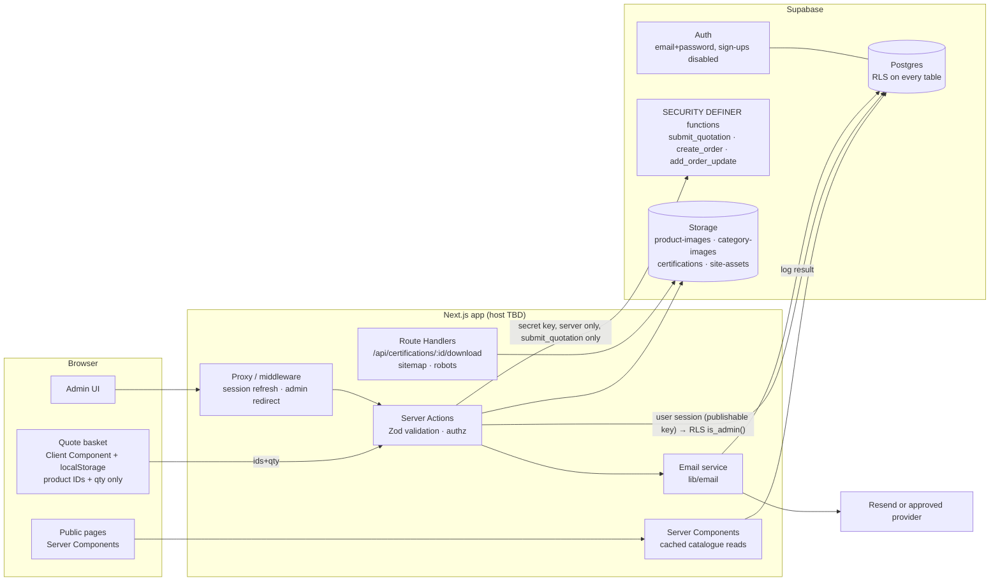

# Technical Plan — Medical & Surgical B2B Catalogue & Quotation Platform

**Status:** Approved 2026-11-21. Stage 2 (foundation) built.
**Inputs:** PRD v1.0, TRD v1.0
**Date:** 2026-11-21

### Decisions log

| Date | Decision |
|---|---|
| 2026-11-21 | Plan approved. |
| 2026-11-21 | **No Docker.** The owner runs the SQL files manually in the Supabase SQL Editor (cloud project). The RLS checks run in the editor (`supabase/tests/rls_checks.sql`) and in `npm test` via PGlite (in-memory Postgres). |
| 2026-11-21 | **Hosting target: Netlify.** Vercel Hobby stays excluded for commercial use (PRD §8). |
| 2026-11-21 | The repo stays in the current OneDrive folder for now (owner's choice by default). The risks are noted in the README. |
| 2026-11-21 | **No emails at all (owner decision, a scope change from PRD §5.5, §6.3 and acceptance criteria 12 and 16).** Quotation requests appear only in the admin panel. Removed: Resend, the email env vars, the `email_logs` table, and `order_updates.notify_customer`. This supersedes A6, §7 "Email", C12 and D-E1 to D-E3 below. The dashboard's "failed emails" figure is replaced by "total orders". Supabase Auth sends no emails either: sign-ups are off and the admin user is created with "Auto Confirm". |
| 2026-11-21 | Keep both `.env` (the owner's copy for deployment) and `.env.local`, with the same values. Both are git-ignored. |
| 2026-11-21 | **Brand: Optimed.** The owner supplied the logo (cyan #009CD8 and navy #222866) and a homepage design reference. The public website (Stage 3) was built before the admin panel, at the owner's request. Marketing copy lives in `src/content/site.ts` and is marked `pendingClientReview`. Contact details come from `site_settings`. Testimonials stay hidden until genuine ones exist. |
| 2026-11-21 | Live finding: newer Supabase projects give `service_role` no table grants. That's fine: the app uses it only for the `submit_quotation` RPC (granted EXECUTE) and Storage signed URLs. The test stub now matches this. |

---

## 0. Repository inspection

- The working folder `Medical webiste` is **empty**. It has no code, no design references, no brand assets and no git repository.
- The PRD mentions "homepage design references supplied by the user". **None were found.**
- **Concern:** the folder is inside **OneDrive**. Syncing `node_modules`, `.next` and the local Supabase Docker volumes through OneDrive is slow, can lock files during builds, and could leak `.env.local` into cloud sync. **Recommendation:** put the repo outside OneDrive (for example `C:\dev\medical-b2b-platform`), or exclude the folder from sync.

---

## 1. System architecture

This is a modular monolith: one Next.js app (App Router, TypeScript) plus one Supabase project.



### Key architectural decisions

| # | Decision | Rationale |
|---|---|---|
| A1 | **Admin actions run as the logged-in user**, with a publishable key and the user's JWT. Authorization is enforced by **RLS via `is_admin()`**, and server actions also call `requireAdmin()`. | Defence in depth. A bug in a server action cannot bypass RLS. The service-role/secret key is not used for admin work. |
| A2 | **The secret (service-role) key is used in exactly one path:** the public quotation submission, which calls `submit_quotation()`. `EXECUTE` on that function is granted to `service_role` only. | Anonymous users cannot call the RPC directly and skip the server's rate limit and honeypot. The key stays in one audited server module, `lib/supabase/admin.ts`, which imports `server-only`. |
| A3 | **Multi-row writes are Postgres functions.** These are quotation + items, order + items + first update, and order update + status change. | The TRD requires transactions. supabase-js has no client-side transactions, so each write runs as one function call, which is atomic. |
| A4 | **References come from Postgres sequences:** `QT-2026-000123` and `ORD-2026-000045`. The format still needs approval. | Concurrency-safe and never generated by the client. Sequences can leave gaps, which is acceptable. |
| A5 | **Idempotency key per submission.** The basket creates a UUID (`submission_key`) per attempt. `quotations.submission_key` is UNIQUE, so a repeated submission returns the existing reference. | Stops double submits and network-retry duplicates. This is not a reference number, so A4 still holds. |
| A6 | **Emails are sent after the database commit and logged in `email_logs`** as `queued → accepted / failed`. Failed emails can be resent from the admin panel. | The PRD says success depends on persistence, not on email. Status is "accepted by provider", never "delivered", unless webhooks are approved (D-E3). |
| A7 | **Public catalogue reads are cached.** They use Next.js cache tags (`products`, `category:<slug>`, …), and admin mutations call `revalidateTag`. Admin and quotation data is never cached. | Performance on free tiers. Private data is never cached publicly. |
| A8 | **Each domain is one feature module:** `src/features/<domain>/{schemas,queries,actions,components}`. The TRD's overlapping `services/` and `features/` folders are merged. | Clear module boundaries and no duplicated layers. |
| A9 | **Statuses are `text` + `CHECK` constraints** instead of Postgres enums. | Final status lists are TBD, and a CHECK constraint is easy to change in a migration. |

### Proposed repository structure

```text
medical-b2b-platform/
├── src/
│   ├── app/
│   │   ├── (public)/            layout with SiteHeader/SiteFooter
│   │   │   ├── page.tsx         homepage
│   │   │   ├── about/ products/ products/[slug]/ categories/[slug]/
│   │   │   ├── quote/ certifications/ contact/
│   │   │   └── privacy-policy/ terms-and-conditions/
│   │   ├── admin/
│   │   │   ├── login/
│   │   │   └── (protected)/     layout calls requireAdmin()
│   │   │       ├── dashboard/ products/ products/new/ products/[id]/edit/
│   │   │       ├── categories/ quotations/ quotations/[id]/
│   │   │       ├── orders/ orders/new/ orders/[id]/
│   │   │       └── certifications/ settings/
│   │   ├── api/certifications/[id]/download/route.ts
│   │   ├── sitemap.ts  robots.ts  layout.tsx  globals.css
│   ├── components/{ui,layout,shared}   # shadcn primitives + shared shells
│   ├── features/{products,categories,quotations,orders,certifications,settings,dashboard}/
│   │   ├── schemas.ts     Zod (shared client/server)
│   │   ├── queries.ts     reads (server-only)
│   │   ├── actions.ts     'use server' mutations
│   │   └── components/
│   ├── lib/
│   │   ├── supabase/{server.ts,browser.ts,admin.ts,proxy.ts}
│   │   ├── auth/require-admin.ts
│   │   ├── email/{client.ts,templates/,send.ts}
│   │   ├── security/{rate-limit.ts,honeypot.ts,upload.ts}
│   │   └── utils/
│   ├── types/database.ts  (generated by `supabase gen types`)
│   └── config/{site.ts,statuses.ts,limits.ts}
├── supabase/{migrations/,seed.sql (dev-only fixtures),config.toml}
├── tests/{unit,integration,e2e}
├── docs/
├── .env.example
└── README.md
```

---

## 2. Database ER diagram

```mermaid
erDiagram
  auth_users ||--o| admins : "is"
  categories ||--o{ subcategories : has
  categories ||--o{ products : contains
  subcategories |o--o{ products : "optionally contains"
  products ||--o{ product_images : has
  quotations ||--|{ quotation_items : has
  products |o--o{ quotation_items : "referenced (SET NULL)"
  quotations |o--o{ orders : "converted to"
  orders ||--|{ order_items : has
  products |o--o{ order_items : "referenced (SET NULL)"
  orders ||--o{ order_updates : history
  email_logs }o--o| quotations : "related_type=quotation"
  email_logs }o--o| orders : "related_type=order"

  admins { uuid user_id PK_FK text full_name timestamptz created_at }
  categories { uuid id PK text name text slug UK text description text image_path bool is_published int display_order }
  subcategories { uuid id PK uuid category_id FK text name text slug text description text image_path bool is_published int display_order }
  products { uuid id PK uuid category_id FK uuid subcategory_id FK text name text slug UK text product_code text manufacturer text short_description text description jsonb specifications bool is_featured int featured_order bool is_published tsvector search_vector }
  product_images { uuid id PK uuid product_id FK text storage_path text alt_text int display_order bool is_primary }
  quotations { uuid id PK text reference_number UK uuid submission_key UK text customer_name text company_name citext business_email text phone_number text country text additional_message text status text internal_notes }
  quotation_items { uuid id PK uuid quotation_id FK uuid product_id FK_nullable text product_name_snapshot text product_code_snapshot int quantity }
  orders { uuid id PK text order_reference UK text internal_reference uuid quotation_id FK text customer_name text company_name citext customer_email text phone_number text country text status text internal_notes }
  order_items { uuid id PK uuid order_id FK uuid product_id FK_nullable text product_name_snapshot text product_code_snapshot int quantity }
  order_updates { uuid id PK uuid order_id FK text status text message bool notify_customer uuid created_by FK }
  certifications { uuid id PK text title text description text document_path text document_type date issue_date date expiry_date bool is_published int display_order }
  email_logs { uuid id PK text related_type uuid related_id citext recipient_email text email_type text provider_message_id text status int attempt_count text error_message }
  site_settings { text setting_key PK jsonb setting_value bool is_public }
  rate_limit_events { bigint id PK text action text key_hash timestamptz created_at }
```

Columns that differ from the TRD are explained in §3. All tables also get `created_at`, and mutable tables get `updated_at`, maintained by a shared trigger.

---

## 3. SQL migrations plan

Every change is a timestamped file in `supabase/migrations/`, created with `supabase migration new`. Each migration is tested locally (`supabase db reset`) before it goes to any remote project.

| # | Migration | Contents |
|---|---|---|
| 001 | `extensions_and_helpers` | `citext`, `pg_trgm`, `unaccent`. `set_updated_at()` trigger function. A private `app` schema for internal functions. |
| 002 | `admins_and_is_admin` | `admins(user_id uuid PK references auth.users on delete cascade, full_name, timestamps)`. `app.is_admin()`: `SECURITY DEFINER`, `STABLE`, `set search_path = ''`, checks `auth.uid()` against `admins`. The first admin is inserted manually (documented step), never through the app. |
| 003 | `categories` | `categories` and `subcategories`. `UNIQUE(category_id, slug)` on subcategories. `ON DELETE RESTRICT` from subcategories → categories. Index `(is_published, display_order)`. |
| 004 | `products` | `products` with category FK `RESTRICT` and subcategory FK `RESTRICT`. A trigger checks that the subcategory belongs to the same category. `specifications jsonb` stored as an ordered array `[{label, value}]` and checked with `jsonb_typeof = 'array'`. Generated `search_vector` (name A, product_code A, manufacturer B, short_description C). GIN index on `search_vector`, trigram GIN on `product_code` and `name`. Btree indexes on `slug`, `category_id`, `subcategory_id`, and partial indexes `WHERE is_published` / `WHERE is_featured AND is_published`. **No price columns.** |
| 005 | `product_images` | FK `ON DELETE CASCADE` (a server action also deletes the storage objects). Partial unique index: one `is_primary` per product. |
| 006 | `quotations` | `quotations` with sequence `quotation_ref_seq`, `status` CHECK, `submission_key` UNIQUE, `char_length` CHECKs on all text fields. `quotation_items` with `quantity int CHECK (quantity between 1 and :max)`, `product_id` **nullable, `ON DELETE SET NULL`**, and `UNIQUE(quotation_id, product_id)`. Indexes on `status`, `created_at desc`, `reference_number`, and trigram on `company_name` / `business_email` for admin search. |
| 007 | `orders` | `orders` with `order_ref_seq`, `quotation_id` FK `ON DELETE RESTRICT` (nullable), and status CHECK. `order_items` (product FK `SET NULL`). `order_updates` (FK cascade, `created_by` → admins). Indexes on `status`, `created_at`, `order_reference`. |
| 008 | `certifications` | Adds `issue_date` and `expiry_date`, which the PRD needs and the TRD omitted. Allows `pdf / image` document types. |
| 009 | `email_logs` | `related_type` CHECK (`quotation`, `order`). Status CHECK (`queued`, `accepted`, `failed`, plus `delivered` / `bounced` only if webhooks are approved). Only metadata is stored: **no email bodies**. |
| 010 | `site_settings` | `setting_key` PK, `setting_value jsonb`, `is_public bool`. Seeded with **empty** keys (company_name, contact_email, …) and no invented values. |
| 011 | `rate_limit_events` | Holds hashed IPs (HMAC with a server secret) only. Pruned by `pg_cron` if available, otherwise opportunistically in the submit function. |
| 012 | `rpc_functions` | `app.submit_quotation(payload jsonb)`, `app.create_order(payload jsonb)`, `app.add_order_update(order_id, status, message, notify)`, `app.dashboard_metrics()`. Details below. |
| 013 | `rls_policies` | All policies in §4. `REVOKE ALL` on tables from `anon` / `authenticated` first, then explicit `GRANT`s. |
| 014 | `storage_buckets_and_policies` | Buckets, MIME and size limits on each bucket (`allowed_mime_types`, `file_size_limit`), and `storage.objects` policies. |

### Function contracts

**`submit_quotation(payload)`.** `SECURITY DEFINER`, granted to `service_role` only. It does the following in one transaction:
1. If `submission_key` already exists, it returns the existing reference.
2. It checks the rate limit (N submissions per hashed IP per window). If exceeded, it raises `RATE_LIMITED`.
3. It locks and fetches products `WHERE id = ANY(ids) AND is_published` with a published category. A missing ID raises `INVALID_PRODUCTS`.
4. It checks the quantities (1 to max, at most M lines).
5. It inserts the quotation using `nextval`-based references and status `new`.
6. It inserts the items with **snapshots read from the database**, not from the payload.
7. It returns `{id, reference_number, items}` for the email.

**`create_order(payload)`.** `SECURITY INVOKER` with an `is_admin()` guard. It does the following in one transaction:
1. It optionally copies customer and items from a quotation.
2. It inserts the order and items.
3. It inserts the first `order_updates` row.
4. It optionally sets the quotation to `converted_to_order` (D-W2).

**`add_order_update(...)`.** `SECURITY INVOKER` with an admin guard. It inserts the history row and updates `orders.status` atomically. The server action then sends the email if `notify_customer` is set and logs it.

---

## 4. RLS security matrix

RLS is **enabled and forced on every table**. `anon` = public visitor. `authenticated` = any logged-in user. `admin` = authenticated **and** `app.is_admin()`. Sign-ups are disabled in Supabase Auth, but RLS still never treats a plain authenticated user as an admin.

| Table | anon SELECT | anon INSERT/UPDATE/DELETE | authenticated (not admin) | admin |
|---|---|---|---|---|
| admins | ✗ | ✗ | own row SELECT only | SELECT (managed manually) |
| categories | `is_published` | ✗ | same as anon | full CRUD |
| subcategories | `is_published` AND parent category published | ✗ | same as anon | full CRUD |
| products | `is_published` AND category published AND (subcategory null or published) | ✗ | same as anon | full CRUD |
| product_images | the parent product passes the product policy | ✗ | same as anon | full CRUD |
| quotations | ✗ | ✗ (insert only through the service-role RPC) | ✗ | SELECT, UPDATE (status, internal_notes). No DELETE (D-Q4) |
| quotation_items | ✗ | ✗ | ✗ | SELECT |
| orders | ✗ | ✗ | ✗ | SELECT, INSERT, UPDATE (through the RPC) |
| order_items | ✗ | ✗ | ✗ | full CRUD |
| order_updates | ✗ | ✗ | ✗ | SELECT, INSERT (append-only: no UPDATE/DELETE) |
| certifications | `is_published` | ✗ | same as anon | full CRUD |
| email_logs | ✗ | ✗ | ✗ | SELECT (written by server code) |
| site_settings | `is_public` | ✗ | same as anon | SELECT all, UPDATE |
| rate_limit_events | ✗ | ✗ | ✗ | ✗ (only the definer function can access it) |

### Storage policies

| Bucket | Visibility | Read | Write/Delete |
|---|---|---|---|
| `product-images` | Public bucket, random UUID paths | Anyone with the URL | admin only |
| `category-images` | Public bucket | Anyone with the URL | admin only |
| `site-assets` (logo; **added**, the TRD has none) | Public bucket | Anyone | admin only |
| `certifications` | **Private** | Through `/api/certifications/[id]/download`, which checks `is_published` and returns a short-lived signed URL | admin only |

Upload validation happens **server-side** in `lib/security/upload.ts`:
- An allowlist of MIME types and extensions (images: jpg, png, webp, avif; documents: pdf).
- A magic-byte check.
- A size cap, also enforced by the bucket.
- Paths of the form `{entity_id}/{uuid}.{ext}`, so client file names are never used.
- `upsert: false`, so existing files are never overwritten.

### RLS tests (integration, local Supabase)

A matrix test signs in three clients (anon, a plain authenticated user, admin) and checks every cell of the table above: allowed actions succeed and denied actions return 0 rows or an error. It also checks that the anon key cannot call the `submit_quotation` RPC directly.

---

## 5. API and server operations plan

Mutations are **server actions** unless noted. Every action: (1) parses input with Zod, (2) calls `requireAdmin()` where needed, which runs `getUser()` and an `is_admin` RPC, (3) calls a feature query or RPC, (4) maps errors to safe messages, and (5) calls `revalidateTag` for the affected public data.

### Public

| Operation | Type | Notes |
|---|---|---|
| List categories, subcategories, featured products | RSC query, cached | Published only |
| List and search products `?q=&category=&sub=&page=` | RSC query, cached per param set | `websearch_to_tsquery` plus trigram fallback for codes, `range()` pagination (24/page), `count: 'estimated'` past a threshold |
| Product detail by slug | RSC query, cached | `notFound()` if unpublished. Related products come from the same subcategory or category. |
| `hydrateBasket(ids[])` | Server action (read) | Returns name, code, image and slug for basket display. Unknown or unpublished IDs are removed from the basket. |
| `submitQuotation(form)` | Server action | Honeypot field and minimum fill time, Zod, HMAC of the IP, RPC with the secret key, Resend notification, `email_logs`. Returns the reference. The basket is cleared only on success. |
| Certification download | Route handler GET | Published check, then a 302 to a signed URL with a 60 s TTL |
| `sitemap.ts`, `robots.ts` | Metadata routes | Published products and categories only. Admin routes are disallowed. |

### Admin (all require admin)

| Domain | Operations |
|---|---|
| Auth | `signIn`, `signOut`. The proxy refreshes the session. There is no sign-up and no password-reset UI unless approved (D-A2). |
| Dashboard | `dashboard_metrics()` RPC: real counts plus the 5 most recent quotations and orders |
| Products | list/search/filter, create, update, delete (with confirmation; D-P5 on archive versus hard delete), toggle publish/featured, reorder featured, upload/reorder/delete images, set primary image |
| Categories | CRUD categories and subcategories, reorder, publish toggle, upload image. Delete is blocked when products or subcategories reference the item, and the UI explains why. |
| Quotations | list (search by reference, company, email; filter by status and date), detail, change status, edit internal notes, resend notification email |
| Orders | create (from a quotation or blank), list/search/filter, detail, edit info and items, `addOrderUpdate` (optional customer email), resend email |
| Certifications | upload, edit metadata, publish toggle, reorder, delete (removes the storage object) |
| Settings | edit company name, logo, email, phone, address, socials, footer text |

---

## 6. Environment variables

The newer Supabase key format (`sb_publishable_…` / `sb_secret_…`) is used. The legacy anon/service_role JWT keys are fallbacks if the project was created with them.

```env
# Public (safe to expose)
NEXT_PUBLIC_SUPABASE_URL=
NEXT_PUBLIC_SUPABASE_PUBLISHABLE_KEY=
NEXT_PUBLIC_SITE_URL=

# Server only — never prefix with NEXT_PUBLIC_
SUPABASE_SECRET_KEY=
RESEND_API_KEY=
EMAIL_FROM_ADDRESS=            # must be on a domain verified with the email provider
COMPANY_NOTIFICATION_EMAIL=
RATE_LIMIT_HMAC_SECRET=        # random 32+ bytes, used to hash visitor IPs

# Optional, only if approved
TURNSTILE_SITE_KEY= / TURNSTILE_SECRET_KEY=
RESEND_WEBHOOK_SECRET=
```

`.env.local` is gitignored, and `.env.example` contains names only. A typed `config/env.ts` uses Zod to fail the build or boot if a variable is missing. Separate Supabase projects (or local Docker) are used for dev and production, and dev never uses production data.

---

## 7. Deployment and infrastructure options

These were checked on 2026-11-21. Each one must be re-verified on the provider's official pricing and terms pages before signing up.

### Hosting (Next.js runtime)

| Option | Commercial use on free tier | Fit | Risks |
|---|---|---|---|
| **Netlify Free** (recommended candidate) | Allowed, per Netlify's announcement and forum staff | Full Next.js support (SSR, server actions, ISR, Image CDN for `next/image`) | Free tier is now credit-based (reported 300 credits/month), and sites are reportedly **paused** when the credits run out. Exact limits are not yet confirmed from an official page. |
| Cloudflare Workers Free + OpenNext | Not confirmed in the terms I found | Very generous bandwidth, 100k req/day | 3 MiB Worker size limit, **10 ms CPU per request** (tight for SSR), adapter is pre-1.0, `next/image` needs paid Cloudflare Images. **High risk on the free plan.** The $5/mo paid plan is viable but needs approval. |
| Vercel Hobby | **Excluded** (non-commercial only, per PRD/TRD) | — | — |
| Small VPS (Hetzner or similar) + Docker | Yes (paid, about €4–6/mo) | Full control | Paid, so it needs approval, and the client handles server maintenance |

### Database, auth and storage: Supabase Free

The reported limits are 500 MB DB, 1 GB storage, 5 GB egress and 2 projects.

> ⚠ **Two production risks need a client decision (D-H2):**
> 1. **No automatic backups** on the Free plan. This database holds customer quotation and order records.
> 2. **The project is paused after about a week of low database activity.**
>
> Options:
> - **(a) Supabase Pro**, about $25/month. It includes daily backups and no pausing. This is **recommended for production**.
> - **(b) Stay on Free** with a scheduled GitHub Actions job. It would run `supabase db dump` daily into an encrypted artifact or private storage, and the same job would keep the project active. This is cheaper but more fragile, and it does not back up storage files.
>
> Free-tier Supabase image transformations are not available, so image optimization depends on the host (Netlify Image CDN) or pre-sized uploads.

### Email: Resend Free

The reported limits are 3,000/month and **100/day**, with up to 3 verified domains. That should cover quotation notifications and order updates at expected B2B volume. It **requires a domain the client owns**, verified through SPF/DKIM DNS records. Without that domain, emails cannot go to customers. Delivery status ("delivered" / "bounced") needs a public webhook endpoint (D-E3).

### Proposed environments

1. **Local:** Next.js dev server + Supabase CLI. Supabase CLI needs **Docker Desktop on this Windows machine**.
2. **Preview:** Netlify deploy previews against a separate free Supabase "staging" project. The 2-project free limit allows exactly staging + production.
3. **Production.**

Migrations are applied with `supabase db push` only after review. A backup (dump) is taken before each production migration, and down-migration notes are kept per migration.

---

## 8. Contradictions and gaps between the PRD and TRD

| # | Issue | PRD | TRD | Proposed resolution |
|---|---|---|---|---|
| C1 | **Admin route shape** | `/admin/dashboard`, `/admin/products`, … (flat) | `admin/dashboard/products/…` (nested) | Use the PRD's flat URLs, protected through a `(protected)` route group |
| C2 | **Snapshots vs FK** | Quotations must stay readable after product deletion | `quotation_items.product_id` is a required FK, while `order_items.product_id` is nullable | Make both nullable with `ON DELETE SET NULL`. Otherwise products could never be deleted once quoted. |
| C3 | **Admin allowlist** | `admins` table "only if profile data needed" | Same, but the RLS section says "never trust client role" | **An `admins` table is required for security.** Without it, any authenticated Supabase user would count as admin. |
| C4 | **Certification dates** | Optional issue/expiry information | Table has no date columns | Add `issue_date` and `expiry_date` |
| C5 | **Subcategory images and URLs** | Categories have images, and the route is only `/categories/[slug]` | Subcategory slugs are unique *per category*, with no image | Use `/categories/[cat]?sub=[subslug]` or `/categories/[cat]/[sub]`, and add an optional `image_path` (D-C1) |
| C6 | **Order reference** | Admin "enters internal order reference" | `order_reference` is unique, and generation is unspecified | System-generated `order_reference` plus an optional admin-entered `internal_reference` |
| C7 | **Orders without quotations** | "Select an existing quotation" | `quotation_id` nullable | Allow both. Need confirmation whether blank orders are permitted, and whether the quotation must be `Approved` first (D-W1) |
| C8 | **Logo storage** | Settings include the logo | No bucket for site assets | Add a `site-assets` bucket |
| C9 | **Image publicity** | — | Product images "public only when associated with published content" | A public bucket cannot enforce this. Use unguessable UUID paths (unpublished images are not listed anywhere, but anyone with the URL can see them). Private buckets with signed URLs would break CDN caching. Needs sign-off (D-S1) |
| C10 | **Repo structure** | — | Has `features/`, `services/` and `lib/` all holding business logic | Consolidate into `features/<domain>/` |
| C11 | **Featured ordering** | Featured products "manageable" | Only an `is_featured` boolean | Add `featured_order` |
| C12 | **Email "retry strategy"** | — | Retry transient failures | Free serverless hosts have no queue. Use one inline retry with backoff, plus a manual "Resend" button from `email_logs`. No background worker unless approved. |
| C13 | **Supabase key naming** | — | `ANON_KEY` / `SERVICE_ROLE_KEY` | Use `PUBLISHABLE_KEY` / `SECRET_KEY` (the TRD allows this) |
| C14 | **Testimonials and FAQ** | Homepage sections 9 and 10 are listed as page sections | Not in the DB unless approved | Build the components, but **hide each section until genuine content exists**. The FAQ is hard-coded from approved answers, unless dynamic management is approved. |
| C15 | **"Free hosting" vs "production-ready"** | Free hosting required | Backups and a rollback plan required | Supabase Free has no backups. Needs D-H2. |
| C16 | **Availability FAQ** | FAQ asks about availability | Stock fields TBD | Answer stays a placeholder. No stock fields. |
| C17 | **Contact page** | `/contact` route and "contact the company" | No contact-form table or email template | Assume a **contact information page only**, with no form, unless a form is approved (D-G1) |

---

## 9. Unresolved decisions

None of these will be decided silently. Items marked **(blocking Stage 2)** are needed before the foundation work starts. The rest can wait until the feature that needs them.

### Infrastructure and accounts
- **D-H1 (blocking):** Hosting provider. The recommended candidate is Netlify Free, subject to confirming its credit limits.
- **D-H2 (blocking):** Supabase Free + DIY dump backups, or Supabase Pro for production.
- **D-H3:** Supabase region, which matters for data residency and the privacy policy.
- **D-H4 (blocking):** Who owns the accounts (GitHub, Supabase, hosting, Resend): the client or the developer, with transfer later?
- **D-H5:** Domain name. It is needed for the email sender, canonical URLs and sitemap.
- **D-H6:** Move the repo out of OneDrive (recommended), and confirm Docker Desktop is available for local Supabase.

### Email
- **D-E1:** Final email provider (Resend Free proposed) and sender address.
- **D-E2:** Company notification address (TBD in the PRD).
- **D-E3:** Delivery webhooks for delivered/bounced status: yes or no.

### Auth and security
- **D-A1:** Admin login by email + password (proposed) or magic link.
- **D-A2:** Should admins have password reset and change in the UI? A forgot-password flow is recommended.
- **D-S1:** Public bucket with UUID paths for product/category images: OK? (C9)
- **D-S2:** Spam protection: honeypot, timing and DB rate limit (proposed, no external service), or also Cloudflare Turnstile (free, but an external service)?
- **D-S3:** Maximum quantity per line and maximum lines per quotation, for example 1–100,000 and 100 lines.

### Catalogue
- **D-C1:** Subcategory URL scheme and whether subcategories have images. (C5)
- **D-C2:** Real categories, product data format and initial count. **Is CSV/Excel bulk import needed?** A large catalogue without import means manual entry, one product at a time.
- **D-C3:** Search by manufacturer: yes or no. Should a manufacturer filter exist?
- **D-C4:** Product codes and specifications: is the ordered free-form label/value list acceptable?
- **D-P5:** Product delete: hard delete (proposed, with snapshot protection), or archive instead?
- **D-C5:** PDF catalogue download: in or out?

### Workflow
- **D-Q1:** Final quotation statuses. Proposed: `new, under_review, contacted, approved, rejected, converted_to_order`.
- **D-Q2:** Reference formats `QT-YYYY-NNNNNN` and `ORD-YYYY-NNNNNN`: OK?
- **D-Q3:** Country field: an ISO country dropdown (proposed) or free text?
- **D-Q4:** Can admins delete quotations or orders? Proposed: no, statuses only, for auditability.
- **D-W1:** Must a quotation be `approved` before it is converted? Are orders without a quotation allowed?
- **D-W2:** Should creating an order automatically set the quotation to `converted_to_order`?
- **D-W3:** Final order statuses. Proposed: `processing, confirmed, dispatched, delivered, cancelled`. Which ones allow customer emails?

### Content (client must supply; placeholders are clearly marked until then)
- **D-G1:** A contact form, or contact info only? (C17)
- Company name, logo, introduction, contact details, social links.
- Certifications and documents (genuine only).
- Testimonials (genuine and approved), and whether they are managed dynamically.
- FAQ answers.
- Privacy Policy and Terms text. These should be written or reviewed by the client's legal adviser. The privacy policy must reflect the data actually collected (name, company, email, phone, country) and the processors used (Supabase, the host, the email provider).
- Design references: the PRD mentions references, but none were supplied.

---

## 10. Implementation stages (after approval)

1. **Stage 2 – Foundation:**
   - git init and the GitHub repo
   - Next.js (latest stable, verified at the time) + TS strict + Tailwind v4 + shadcn/ui
   - Supabase CLI, migrations 001–014, generated types
   - auth, `requireAdmin`, env validation
   - design tokens and typography
   - Vitest + Playwright scaffold, RLS matrix tests

   *Review checkpoint.*
2. **Stage 3 – Public site:** header and footer, home, catalogue with search and pagination, category and product pages, quote basket and form, certifications, contact, legal, SEO (metadata, sitemap, robots, OG).
3. **Stage 4 – Admin:** dashboard, products, categories, quotations, orders, certifications, settings.
4. **Stage 5 – Workflows and email:** submit RPC hardening, order RPCs, email service, logs, resend.
5. **Stage 6 – QA:** unit, integration (RLS) and e2e (the 13-step journey in TRD §17), unauthorized-access tests on every admin action, responsive and accessibility pass, Lighthouse, production build.
6. **Stage 7 – Deployment:** only after D-H1 to D-H5 are resolved. Includes deployment documentation and a backup runbook.

---

## Sources (provider checks, 2026-11-21)

- Netlify free plan & commercial use: https://netlify.com/blog/introducing-netlify-free-plan · https://answers.netlify.com/t/can-we-use-netlify-free-plan-for-commercial-purposes/41545 · https://www.costbench.com/software/cloud-infrastructure/netlify/free-plan/
- Cloudflare Workers / OpenNext limits: https://opennext.js.org/cloudflare · https://developers.cloudflare.com/workers/platform/limits
- Resend limits: https://resend.com/pricing · https://resend.com/docs/knowledge-base/account-quotas-and-limits
- Supabase free plan & pausing: https://supabase.com/pricing · https://supabase.com/docs/guides/platform/free-project-pausing
